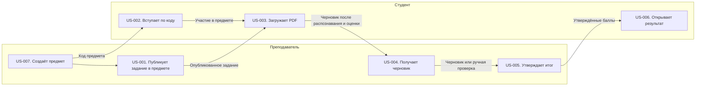

# Карта пользовательских историй Scan Grader

За документ отвечает Артур (P1). Статус сдачи указан в [индексе пакета](../../README.md#контрольные-точки).

Карту можно редактировать в таблицах или в схеме Mermaid. Для защиты подготовлен [экспорт в SVG](usm.svg). Критерии приёмки находятся в [карточках историй](stories.md). Строка «Следующий релиз» показывает, что можно добавить после MVP.

## Сценарии и дорожки

| Дорожка | 1. Создать предмет | 2. Опубликовать задание | 3. Вступить в предмет | 4. Сдать работу | 5. Получить черновик | 6. Утвердить оценку | 7. Увидеть результат |
| --- | --- | --- | --- | --- | --- | --- | --- |
| Преподаватель | US-007. Создаёт предмет и получает код | US-001. Публикует в предмете задание с эталоном | | | US-004. Получает баллы и комментарии по задачам | US-005. Если нужно, исправляет результат перед утверждением | |
| Студент | | | US-002. Заполняет профиль и вводит код | US-003. Открывает задание в предмете, загружает PDF и видит статус | | | US-006. Получает итог по своим задачам |
| Передача | Преподаватель делится кодом предмета | Опубликованное задание видно участникам | Сервис сохраняет участие студента | Сервис обрабатывает PDF по версии эталона | Преподаватель видит черновик или причину ручной проверки | После утверждения итог доступен владельцу сдачи | Студент получает обратную связь |

**Сценарий 1. Сдача и предварительная проверка.** Преподаватель создаёт предмет и публикует задание. Студент вступает по коду, после чего сдаёт PDF и ждёт проверки (US-007 → US-001 → US-002 → US-003 → US-004).

**Сценарий 2. Утверждение результата.** Преподаватель открывает принятую сдачу, когда доступен черновик или указана причина ручной проверки. После утверждения студент получает итог (US-005 → US-006).

## Срезы релизов

| Срез | Создать предмет | Опубликовать задание | Вступить в предмет | Сдать работу | Получить черновик | Утвердить оценку | Увидеть результат |
| --- | --- | --- | --- | --- | --- | --- | --- |
| **MVP** | **US-007**. Преподаватель создаёт предмет и получает код | **US-001**. В предмете появляется задание с закрытым эталоном `.tex` | **US-002**. Студент заполняет профиль и вступает по коду | **US-003**. После загрузки PDF студент видит статус | **US-004**. Для каждой задачи показан балл с комментарием | **US-005**. Преподаватель может исправить баллы перед утверждением | **US-006**. Студент открывает свой итог |
| Следующий релиз | Сопреподаватели | Черновик эталона от ИИ | Обновление кода | Повторная сдача | Другие форматы эталона | Экспорт оценок | Уведомление |
| Вне объёма | Управление учебными группами | Задания по другим дисциплинам | Массовый импорт участников | Сканирование в браузере | | Аннотирование PDF | Публикация оценки без преподавателя |
