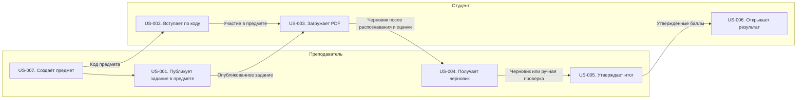

# Карта пользовательских историй Scan Grader

За карту отвечает Артур (P1). Таблицы и схему Mermaid можно редактировать. [Карта в SVG](usm.svg) · [Критерии приёмки](stories.md) · [Статус сдачи](../../README.md#контрольные-точки)

## Сценарии и дорожки

| Дорожка | 1. Создать предмет | 2. Опубликовать задание | 3. Вступить в предмет | 4. Сдать работу | 5. Получить черновик | 6. Утвердить оценку | 7. Увидеть результат |
| --- | --- | --- | --- | --- | --- | --- | --- |
| Преподаватель | US-007. Создаёт предмет и получает код | US-001. Публикует в предмете задание с эталоном | | | US-004. Получает балл с комментарием по каждой задаче | US-005. При необходимости исправляет оценку и утверждает итог | |
| Студент | | | US-002. Заполняет профиль и вводит код | US-003. В задании своего предмета загружает PDF и видит статус | | | US-006. Открывает итог по своим задачам |
| Передача | Преподаватель сообщает студентам код | Участникам видно опубликованное задание | Сервис сохраняет участие студента | Сервис проверяет PDF по закреплённой версии эталона | Преподаватель видит черновик или причину ручной проверки | Утверждённый итог доступен автору сдачи | Студент узнаёт, за что получил свой балл |

**Сценарий 1. Сдача и предварительная проверка.** После вступления по коду студент сдаёт PDF по опубликованному заданию и ждёт проверки (US-007 → US-001 → US-002 → US-003 → US-004).

**Сценарий 2. Утверждение результата.** Преподаватель утверждает оценку по черновику или после ручной проверки, и студент видит её в своей работе (US-005 → US-006).

На КТ-2 шаги 6 и 7 проверили через HTTP на заранее подготовленной сдаче с одной задачей. [Критерии полного сценария и результаты проверок](traceability.md)

## Срезы релизов

«Следующий релиз» включает возможные дополнения после MVP.

| Срез | Создать предмет | Опубликовать задание | Вступить в предмет | Сдать работу | Получить черновик | Утвердить оценку | Увидеть результат |
| --- | --- | --- | --- | --- | --- | --- | --- |
| **MVP** | **US-007**. Создать предмет и получить код | **US-001**. Опубликовать в предмете задание с закрытым эталоном `.tex` | **US-002**. Заполнить профиль и вступить по коду | **US-003**. Загрузить PDF и увидеть статус | **US-004**. Получить балл с комментарием по каждой задаче | **US-005**. При необходимости исправить баллы перед утверждением | **US-006**. Открыть итог по своей работе |
| Следующий релиз | Сопреподаватели | Черновик эталона от ИИ | Обновление кода | Повторная сдача | Другие форматы эталона | Экспорт оценок | Уведомление |
| Вне объёма | Управление учебными группами | Задания по другим дисциплинам | Массовый импорт участников | Сканирование в браузере | | Аннотирование PDF | Публикация оценки без преподавателя |
